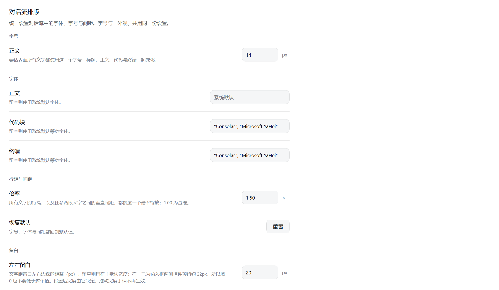

# 对话流排版 · dsh-chat-typography

给 DSH Harness 的对话流加一页排版设置：**一个字号管住全文、一条网格管住所有纵向间距、三种角色各自的字体，以及对话文字到窗口边缘的留白。**

装好后「设置」里会多出一页 **对话流排版**。



## 功能

### 字号：一个值管全部

宿主本身有一套刻意的字号阶梯 —— 标题 21 / 19 / 18px、正文 14px、次要文字 13px、行内代码 12px、代码块 11px。本插件把它**全部压到同一个值**：

```css
[data-chat-flow][data-chat-flow] *:not(textarea):not(input):not(svg):not(svg *) {
  font-size: var(--dsh-content-font-size, 14px) !important;
}
```

改的只是字号，不动字重和字体族：标题照样加粗，代码照样等宽。范围 10–22px。输入控件与图标（`svg`）被排除在外，不参与统一。

这个值写进 Harness 的主题设置，所以**和「外观」页共用同一份** —— 在哪一边改，另一边都跟着显示。

### 字体：文字 / 代码 / 终端 三种角色

三个输入框分别设置 `text` / `code` / `terminal` 的字体族，留空即系统默认。写入走 Harness 的主题服务，所以**和「外观」页共用同一份设置** —— 在这一页改，外观页同步显示；在外观页改，这里也会跟着变。输入不需要自己加引号，服务会做清洗和补引号。

### 行距与间距：所有纵向间隔只走一条网格

这是本插件最花力气的部分。宿主的纵向间距来自三处互不相干的地方：

| 来源 | 宿主取值 |
| --- | --- |
| 行盒 | `line-height: calc(24px + 字号增量)` |
| markdown 块边距 | 段落 16px、列表项之间 6px、标题上 32px |
| 对话流项之间 | `--dsh-chat-flow-gap`：6px / 12px / 16px 三种语境 |

三者叠加的结果是：**同一个段落里换行是一个间隔，两段之间是第二个，两条消息之间是第三个。** 插件把这三处收敛成同一个数：

- 行盒 = `max((16px + 字号增量) × 倍率, 字号)` —— 跟着字号联动，同时保证不会小到装不下文字
- markdown 文本块（`p`、`ul/ol`、`blockquote`、`h1–h6`、列表项之间）的边距**归零**，于是段内换行和段间换行的步长完全相等
- `--dsh-chat-flow-gap` **归零**，于是两条消息之间、正文与工具行之间，也只隔一个行盒
- 例外：代码块 / 表格 / 分隔线保留 `16px × 倍率` 的上下边距 —— 它们自带边框或底色，归零会让框和正文粘在一起

倍率范围 0.80–2.00，步进 0.05，存在 localStorage 的 `dsh-chat-typography.lineHeight`。**1.00 也是这条统一网格**，不会退回宿主原本参差的间距。

### 恢复默认

一键把三个字号回默认（14 / 11 / 13）、清空三个字体族、行距回 1.00、留白清空。

### 左右留白

数字框设置对话文字距窗口左右边缘的距离（px），留空即宿主的默认宽度。宿主原来的对话列宽是 `clamp(680px, 视口宽 × 0.64, 920px)`，窗口一宽，两侧就空出很大一块；这一项把它收窄。

实现是覆写 `--dsh-chat-content-width`：对话流列、输入框卡片、用户气泡堆、宽表格都从这一个变量取宽度，所以它们会一起收窄并保持互相对齐。宿主已经为输入框两侧控件预留了 `--dsh-composer-side-clearance + 16px`（约 32px），所以填 0 也不会小于这个下限。设置此项后，宿主的「拖宽」手柄不再生效。

## 设置项一览

| 设置项 | 控件 | 范围与默认 | 存放位置 |
| --- | --- | --- | --- |
| 字号 | 数字框 | 10–22px，默认 14（宿主默认） | Harness 主题设置（与「外观」共用） |
| 字体 · 文字 / 代码 / 终端 | 文本框 | 留空 = 系统默认 | 同上 |
| 行距 | 数字框 | 0.80–2.00，步进 0.05，默认 1.00 | localStorage `dsh-chat-typography.lineHeight` |
| 左右留白 | 数字框 | 0–600px，留空 = 宿主默认 | localStorage `dsh-chat-typography.gutter` |

数字框回车或失焦提交；输入非法值会退回原值。

## 安装

在 Harness 的插件管理器里安装，`target` 传包名：

```
@zheshiyigehenchang/dsh-chat-typography
```

也可以从源码安装：先把本仓库 clone 到本地，再往管理器里传**包目录的绝对路径**（例如 `<你的克隆目录>\dsh-chat-typography`），管理器会：

1. 往 `<DSH_HOME>\profiles\<profile>\package.json` 的 `dependencies` 写入 `"@zheshiyigehenchang/dsh-chat-typography": "link:<包目录>"`
2. 把包名追加进该文件的 `dsh.profile.bundles`
3. 执行 pnpm 链接，`node_modules\@zheshiyigehenchang\dsh-chat-typography` 变成指向源码目录的符号链接

包目录不必放在 workspace 里；链接之后**源码即产物**，改 `client.js` 刷新页面就生效，不需要重新安装。

装完**刷新页面**即可，不需要重启 Harness。验证：打开设置，导航里应出现「对话流排版」。

## 目录结构

```
dsh-chat-typography/
├── package.json          包清单：exports / files / dsh.bundle.patch / dsh.client
├── cordis.patch.yml      向 profile 插入 bundle 行的 patch
├── index.js              Host 半个 bundle（本插件没有 Host 逻辑，只有空 apply）
├── client.js             全部实现：设置页 + 三层样式
├── locale/
│   ├── zh.json           插件列表里的显示名与简介
│   └── en.json
├── icon.svg              插件列表图标
└── docs/                 README 里的截图
```

`client.js` 里叠了若干层样式，各自独立注入一个 `<style data-plugin-css=...>`：

| 层 | 作用域 | 是否常驻 |
| --- | --- | --- |
| 统一字号 | `[data-chat-flow]` 内除输入控件与图标 | 常驻 |
| 行距与间距 | `[data-chat-flow]`，内容随倍率重写 | 常驻（倍率 1.00 也写） |
| 正文节奏归零 | `[data-chat-flow]` 内 markdown 的段落 / 列表 / 标题 / 引用 / 分割线 | 常驻 |
| 行内代码去底色 | `[data-chat-flow]` 内 markdown 的 `:not(pre)>code` 与文件提及 | 常驻 |
| 表格单元格收紧 | `[data-chat-flow]` 内 markdown 表格 | 常驻 |
| 代码卡片收紧 | `[data-chat-flow]` 内代码块、卡片 | 常驻 |
| 标题栏收紧 | `header.wSkVaW_header`（无标签行时） | 常驻 |
| 左右留白 | `:has([data-chat-flow])` 上的 `--dsh-chat-content-width` | 仅在填了数值时 |

后四层（正文节奏、行内代码、表格、代码卡片、标题栏）是**固定的紧凑化**，不提供开关，也不随上面任何设置变化。其共同做法是靠提高选择器特异性取胜（重复属性选择器 `[data-chat-flow][data-chat-flow]`、重复类名 `header.wSkVaW_header.wSkVaW_header`），**不使用 `!important`** —— 因为被覆盖的宿主规则本身都不是 `!important`。

## 兼容性与已知限制

- **强依赖宿主内部实现**：`[data-chat-flow]` 钩子，`--dsh-chat-flow-gap`、`--dsh-chat-content-width`、`--dsl-terminal-line-height` 变量，以及 `[class*="_markdown_"]` 这类 CSS Modules 类名半段。宿主大版本升级（尤其是 `dsh-client-ui-chat` 与 `dsh-client-ui-primitives`）可能让某一层失效。类名用的是 localName 半段而不是哈希，跨构建稳定；变量名一旦改了就要跟着改。
- **改动全在浏览器侧**，生效方式是刷新页面。
- 单行的控件行（时间戳、复制/重试按钮行、工具卡标题行）高度由按钮决定，不随行距伸缩。
- 展开状态的步骤进程标题自带 `padding-bottom: 8px`，是固定值，也不随倍率走。
- 字体族的写入依赖主题服务暴露 `setFontFamily`；万一没有，字体分组会自动隐藏，其余功能不受影响。

## 许可

MIT，见 [LICENSE](LICENSE)。
