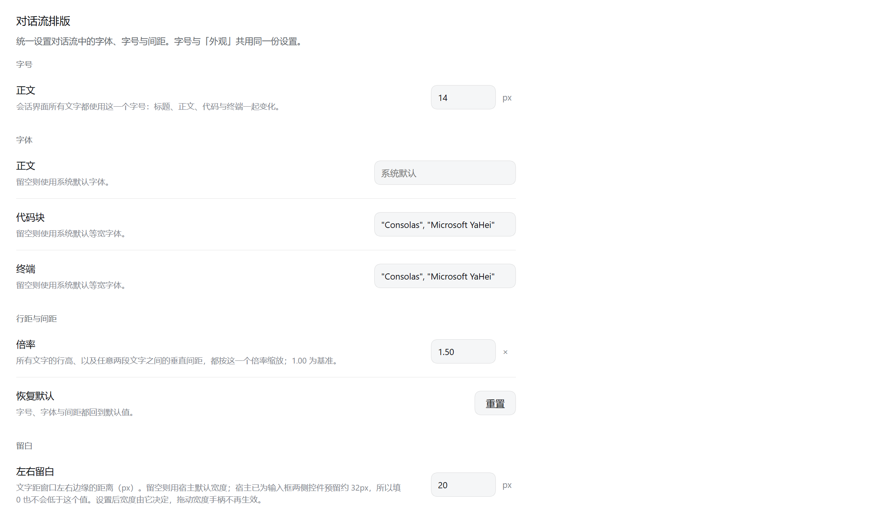

# 对话流排版 · dsh-chat-typography

给 DSH Harness 的对话流加一页排版设置：**一个字号管住全文、一条网格管住所有纵向间距、三种角色各自的字体，以及对话文字到窗口边缘的留白**；此外还固定收紧了几处宿主留白（标题栏、代码块内边距、表格单元格、行内代码药丸底色），让 `③` 这类圈码跟着中文字体走，并可按需隐藏标题栏下方的视图标签行（对话 / 轨迹 / …）、把单行标题栏再压到约 31px。

装好后「设置」里会多出一页 **对话流排版**。



> 上图是设置页的控件组（来源：浅色主题、Windows、默认值 + 代码字体 `Consolas`）。截图只展示设置项本身，上面提到的几处**固定收紧**（标题栏、代码块内边距、表格单元格、行内代码）作用于对话流，不在这张图里。

## 功能

### 字号：一个值管全部

宿主本身有一套刻意的字号阶梯 —— 标题 21 / 19 / 18px、正文 14px、次要文字 13px、行内代码 12px、代码块 11px。本插件把它**全部压到同一个值**：

```css
[data-chat-flow][data-chat-flow] *:not(textarea):not(input):not(svg):not(svg *) {
  font-size: var(--dsh-content-font-size, 14px) !important;
}
```

改的只是字号，不动字重和字体族：标题照样加粗，代码照样等宽。范围 10–22px。输入控件与图标（`svg`）被排除在外，不参与统一。

这个值写进 Harness 的主题设置，所以**和「外观」页共用同一份** —— 在哪一边改，另一边都跟着显示。

### 字体：文字 / 代码 / 终端 三种角色

三个输入框分别设置 `text` / `code` / `terminal` 的字体族，留空即系统默认。写入走 Harness 的主题服务，所以**和「外观」页共用同一份设置** —— 在这一页改，外观页同步显示；在外观页改，这里也会跟着变。输入不需要自己加引号，服务会做清洗和补引号。

### 圈码：③ 跟中文字体走，不跟等宽字体走

宿主允许把正文设成 `"Consolas", "Microsoft YaHei"` 这种混排栈。Consolas 没有汉字，汉字就落到雅黑；但 `③`（U+2462）**在 Consolas 里是有的**，于是它按 Consolas 的设计画出来：0.55em 的小圈，还比汉字基线高出 6px。同一行里因此出现两种大小、两条基线——这是**同一个 `font-size`、不同字体**，任何字号规则都改不回来（实测：Consolas 22px 的 ③ 是 12×12，雅黑 22px 的 ③ 是 21×21）。

修法是让这一块字符改投中文字体，而不是动字号：

```css
@font-face {
  font-family: "dshct-enclosed";
  src: local("PingFang SC"), local("Hiragino Sans GB"), local("Microsoft YaHei"), …;
  unicode-range: U+2460-24FF, U+3251-325F, U+32B1-32BF;  /* ①–⓿、㉑–㉟、㊱–㊿ */
}
[data-chat-flow][data-chat-flow] { font-family: "dshct-enclosed", var(--dsw-font-family) }
```

`unicode-range` 把这层限定在圈码上，其余字符原样落回 `var(--dsw-font-family)`——宿主自己的值——所以**拉丁正文和代码块的字体一处都没变**，只有圈码恢复成 1em 的汉字尺寸、坐回汉字基线。系统里一个中文字体都找不到时，这个 `@font-face` 没有可用源，浏览器直接忽略，等于没装。

markdown 正文自己带着 `font` 简写（里面点名了 `var(--dsw-font-family)`），只在对话流根上写规则够不到它，所以选择器另外点名了 markdown 容器和推理行的 compact 变体。

### 设置页的图标：自己画，不用宿主的齿轮

宿主的设置导航**按 id 发图标**：`navIcon(id)` 只认 `account`、`models`、`agent-presets`、`plugins`、`archived-sessions` 五个内置 id，其余一律退回「设置」齿轮——于是「对话流排版」和「通用设置」顶着同一个齿轮。`settings.section` 的注册只收 `id` / `order` / `label`，要不了图标；改用某个内置 id 又等于把那页换掉。

宿主为此留了一个扩展位：`settings.section.icon` 是 root 作用域的列表槽，**注册项的 `id` 必须与本页 section 的 id 相同**才会被渲染（id 对不上就永不出现），渲染位置是导航行图标 `<span>` 内部、替代默认齿轮，owner props 是 `{ size, active }`。本插件就用它：以 `id: 'chat-typography'` 注册一个 16px 的三行文字 `svg`，描边走 `currentColor`，悬停与选中态跟着整行走，不需要样式表，也不碰宿主 DOM。

早几个版本走的另一条路（按标题文字认出那一行、打 `data-dshct-nav`、用 `mask` 盖掉齿轮）会**同时画出两个图标**：宿主把图标包在内层 `<span class="navIcon">` 里，`[data-dshct-nav]>svg` 这种指向直接子元素的规则根本盖不到齿轮，注入的伪元素反倒在自己的 flex 格里又多画了一个。

### 行距与间距：所有纵向间隔只走一条网格

这是本插件最花力气的部分。宿主的纵向间距来自三处互不相干的地方：

| 来源 | 宿主取值 |
| --- | --- |
| 行盒 | `line-height: calc(24px + 字号增量)` |
| markdown 块边距 | 段落 16px、列表项之间 6px、标题上 32px |
| 对话流项之间 | `--dsh-chat-flow-gap`：6px / 12px / 16px 三种语境 |

三者叠加的结果是：**同一个段落里换行是一个间隔，两段之间是第二个，两条消息之间是第三个。** 插件把这三处收敛成同一个数：

- 行盒 = `max((16px + 字号增量) × 倍率, 字号)` —— 跟着字号联动，同时保证不会小到装不下文字
- markdown 文本块（`p`、`ul/ol`、`blockquote`、`h1–h6`、列表项之间）的边距**归零**，于是段内换行和段间换行的步长完全相等
- `--dsh-chat-flow-gap` **归零**，于是两条消息之间、正文与工具行之间，也只隔一个行盒
- 例外：代码块 / 表格 / 分隔线保留 `16px × 倍率` 的上下边距 —— 它们自带边框或底色，归零会让框和正文粘在一起

倍率范围 0.80–2.00，步进 0.05，存在 localStorage 的 `dsh-chat-typography.lineHeight`。**1.00 也是这条统一网格**，不会退回宿主原本参差的间距。

### 固定收紧的几处留白

下面这些**与倍率无关**，是固定值，也没有开关：

| 位置 | 宿主 | 现在 |
| --- | --- | --- |
| 对话标题栏上下留白（无标签行时） | 各 10px（栏高 51px） | 各 5px（栏高 41px）；勾选「紧凑会话标题栏」后各 0px（栏高 31px） |
| 代码块内部上下内边距 | 16px | 8px |
| 表格单元格内边距 | `10px 16px` | `5px 8px` |
| 行内代码 | 底色 + 描边 + 5px 左右内边距 | 无底色、无描边、无内边距 |

**标题栏收紧**那条带 `:not(:has(.wSkVaW_tabs))` / `:not(:has([data-conversation-tabs]))` 守卫：宿主只在存在标签行时（`tabs.length > 1`）才把标题栏下限锁在 76px。不加守卫的话，一旦某个会话展开出标签行，这个下限会被覆盖掉，标签行就会和内容撞在一起。加守卫后实测：无标签 41px，有标签仍为 76px 不变。

**表格**只收内边距，不动边框。宿主另外把首列左边距和末列右边距归零（让表格左右贴齐），本层的选择器比宿主那两条更深，所以收内边距时会顺带破坏贴齐——因此贴齐也由本层手工还原。

首列若以文件链接图标（`</>`）开头，图标最左侧的描边正好压在滚动容器的裁剪边界上，外圈半像素的抗锯齿会被削掉，看起来像首字符被切了一块。所以滚动容器额外加 `padding-left: 2px`、再用 `margin-left: -2px` 抵掉：表格位置不动，裁剪边界左移 2px，图标的描边就完整了。

**行内代码**去底色是因为宿主对它的处理本来就不一致：普通行内代码画成带底色和描边的"药丸"，而被判为可解析文件路径的那些（deliverables 会把它们改写成带 `_fileMention_` 的按钮）底色与描边被重置掉了。两段看起来一模一样的代码穿着两种不同的衣服，所以干脆都去掉。

### 恢复默认

一键把三个字号回默认（14 / 11 / 13）、清空三个字体族、行距回 1.00、留白清空、视图标签栏恢复显示、紧凑标题栏关闭。

### 左右留白

数字框设置对话文字距窗口左右边缘的距离（px），留空即宿主的默认宽度。宿主原来的对话列宽是 `clamp(680px, 视口宽 × 0.64, 920px)`，窗口一宽，两侧就空出很大一块；这一项把它收窄。

实现是覆写 `--dsh-chat-content-width`：对话流列、输入框卡片、用户气泡堆、宽表格都从这一个变量取宽度，所以它们会一起收窄并保持互相对齐。宿主已经为输入框两侧控件预留了 `--dsh-composer-side-clearance + 16px`（约 32px），所以填 0 也不会小于这个下限。设置此项后，宿主的「拖宽」手柄不再生效。

### 隐藏视图标签栏

勾选后隐藏标题栏下方「对话 / 轨迹 / …」这一行，标题栏只剩一行（与没有标签行时同为 41px）。

这一行是宿主的 View 切换条，由 `dsh-client-ui-conversation` 在**至少注册两个视图**时渲染（`tabs.length > 1`），同时把标题栏下限锁在 76px。所以隐藏它要成对做两件事：把标签行设为 `display:none`，并把标题栏的 `min-height` 归零、上下留白收到 5px——也就是本插件给“无标签行”准备的那套几何。

定位标签行不靠类名哈希：标签列表那层带着稳定的 `data-conversation-tabs` 属性，它的父元素就是整行（`rc.4` 是 `div.wSkVaW_tabs`，官方 `0.2.1-rc.5` 变成 `div.an3WzG_tabs`，哈希每次构建都会变）。所以 CSS 同时保留旧类名规则和 `header :has(> [data-conversation-tabs])` 这条通用规则。

> **注意**：标签行是切换到「轨迹」等其它视图的**唯一入口**，隐藏后界面里就没有切换器了。因此它默认关着，是一个开关而不是固定收紧；需要轨迹时回来取消勾选即可。状态存在 localStorage `dsh-chat-typography.hideViewTabs`（`'1'` 为隐藏）。

### 紧凑会话标题栏

勾选后把会话标题栏上下的 5px 留白归零：单行标题栏从约 41px 压到约 31px（实测留白 5px→41px、0→31px）。字号和右侧「标准模式」胶囊都不缩小，只是栏本身变矮。

它和「隐藏视图标签栏」相互独立：隐藏标签行时两者叠加得到 31px；标签行还显示时，宿主仍把标题栏下限锁在 76px，这一项只是把留白收紧，栏高仍是 76px。状态存在 localStorage `dsh-chat-typography.compactHeader`（`'1'` 为紧凑）。

> 桌面端的**第一行**（文件 / 视图 / 运行 / 帮助、远程、窗口按钮）不归这里管：官方桌面版由 Electron 的原生 `titleBarOverlay` 画它，高度写在安装目录的 `app.asar` 里，页面 CSS 碰不到。要改它用下面的「桌面标题栏」按钮。

### 桌面标题栏（28px）

官方桌面版最上面一行是 Electron 的原生标题栏（`titleBarOverlay`），高度写死在安装目录的 `resources/app.asar` 里：`lib/main.js` 的主窗口 `titleBarOverlay.height`（默认 40）和 `lib/preload-app.cjs` 镜像给页面的 `--dsh-windows-titlebar-height`（默认 `40px`）。两者必须一起改，否则页面会按错的边距排版。

设置页「桌面标题栏 → 写入 28px」按钮打开时会先 `GET` 一次真实状态，只有当本进程能写归档时才允许点击；桌面版里的 Host 永远写不了（见下面 Electron 那段），所以那里按钮是禁用的，状态行直接给出命令行。真正改字节的是 `scripts\patch-desktop-titlebar.mjs`：等长替换只换数字本身，文件长度不变，asar 头和所有偏移因此保持有效；第一次写入前会把整个 `app.asar` 备份到 `%TEMP%\dsh-app-asar-backup\app.asar.orig`。

写入后必须**完全退出 DSH 再启动**才生效（主进程已经加载了 `main.js`）。应用更新会覆盖 `app.asar`、恢复 40px，再跑一次脚本即可。非官方桌面版（浏览器 GUI）会返回「不适用」，不写任何文件。Host 半边是新增代码，安装或更新插件后需要重启一次 DSH 才会注册这条路由。

Host 半边怎么找到 `app.asar`：桌面版把 Host 从包里拉起来，命令行里给的是包内路径 `…\resources\app.asar\dsh`（`argv[2]`），`app.asar` 本身**不作为独立的一段**出现，它的父目录才是真正的归档。所以除了认「以 `app.asar` 结尾的参数」，也认「`…\app.asar\…` 这种包内路径」——取到 `app.asar` 那一段为止。两种形状都只认命令行里真实存在的路径，不会去 LOCALAPPDATA 猜一个安装目录：浏览器 GUI 里点这个按钮不应该写别的副本。`DSHCT_DESKTOP_ASAR` 可以强制指定归档（测试用）。

**Electron 会改写 `app.asar` 的访问**：桌面版的 Host 跑在 Electron 的 Node 里，`fs` 被打过 asar 补丁——`openSync(…\app.asar, 'r')` 和 `'r+'` 都得到 `ENOENT, not found in …\app.asar`（归档本身在它眼里是虚拟目录，`statSync` 还回报 dir），只有归档内部的路径（`…\app.asar\lib\main.js`）才能打开。所以 Host 判断归档是否可用时探测的是内部那行 `lib/main.js`；读高度也是按内部路径读 `lib/main.js` / `lib/preload-app.cjs` 的字节，而不是去解析容器。同一补丁让 Host **完全写不了**归档：容器打不开，走内部路径的写入也不会落到真实字节上。写入因此只在命令行脚本里做——它跑在普通 Node 里，直接改归档字节。

排查顺序（`GET /chat-typography/api/windows-titlebar` 会回报它找到的路径和当前高度）：

| 返回 | 含义 |
| --- | --- |
| `{"ok":true,"height":28,"preload":28,"writable":false,"path":…}` | 找到了归档，现在已经是 28px；按钮禁用，状态行写「无需修改」 |
| `{"ok":true,"height":40,"preload":40,"writable":true,"path":…}` | 找到了归档并且这个进程能写（普通 Node 里才会出现，例如测试或 `DSHCT_DESKTOP_ASAR`），按钮可用 |
| `{"ok":false,"code":"not-desktop"}` | 命令行里没有包内路径：这是浏览器里的 Harness，或者 Host 不是由桌面版拉起的 |
| `{"ok":false,"code":"no-marker","path":…}` | 归档找到了，但 `lib/main.js` 里没有唯一的「主窗口 + `titleBarOverlay.height:`」组合，或 preload 里没有镜像那行；宿主改写法后会出现 |
| `{"ok":false,"code":"unreadable"}` / POST 返回 `{"code":"io"}` | 归档在、但读不到（或 Host 写不了——桌面版里总是这个结果） |

> `writable` 说的是「这个进程现在能不能改归档字节」：桌面版里的 Host 恒为 `false`（Electron 的 asar 层不允许，见上），按钮随之禁用并把命令行写进状态行；命令行脚本在普通 Node 里跑，是真的就地写字节。

按钮不会在状态未知时可用：设置页打开时先 `GET` 一次，只有「找到归档 + 当前还不是 28px」成立才允许点击，下面那行状态会直接写出当前高度、待重启、或为什么改不了（没找到 / 结构不认识 / 浏览器里不适用）。

**已知限制**：桌面版里打开的那个界面，Host 半边可能是启动时打进归档视图的旧副本，与设置页显示的文案不一致。出现「文案变了、按钮还报错」时，不要反复点按钮，直接用命令行脚本改一次（见下）。

手动路径（可在桌面版运行时执行：脚本用普通 Node 直接改归档字节，会自动备份并跳过已经是 28px 的情况）：

```powershell
# 在当前目录（插件仓库）下执行；脚本自己找安装目录的 app.asar
node scripts\patch-desktop-titlebar.mjs 28
# 需要时也可以显式给路径：node scripts\patch-desktop-titlebar.mjs 28 "C:\...\resources\app.asar"
```

注意 `cd` 到插件仓库根目录（`dsh-chat-typography\`）再运行：脚本在仓库的 `scripts\` 子目录里，在工作区顶层 `node scripts\...` 会报 `Cannot find module`。

## 设置项一览

| 设置项 | 控件 | 范围与默认 | 存放位置 |
| --- | --- | --- | --- |
| 字号 | 数字框 | 10–22px，默认 14（宿主默认） | Harness 主题设置（与「外观」共用） |
| 字体 · 文字 / 代码 / 终端 | 文本框 | 留空 = 系统默认 | 同上 |
| 行距 | 数字框 | 0.80–2.00，步进 0.05，默认 1.00 | localStorage `dsh-chat-typography.lineHeight` |
| 左右留白 | 数字框 | 0–600px，留空 = 宿主默认 | localStorage `dsh-chat-typography.gutter` |
| 隐藏视图标签栏 | 复选框 | 默认关闭（显示标签行） | localStorage `dsh-chat-typography.hideViewTabs` |
| 紧凑会话标题栏 | 复选框 | 默认关闭（留白 5px / 41px） | localStorage `dsh-chat-typography.compactHeader` |
| 桌面标题栏 | 按钮 | 写入 28px（官方默认 40） | 安装目录 `app.asar`（命令行脚本就地改写；桌面版内的 Host 受 Electron 限制，只给状态与提示） |

数字框回车或失焦提交；输入非法值会退回原值。

## 安装

在 Harness 的插件管理器里安装，`target` 传包名：

```
@zheshiyigehenchang/dsh-chat-typography
```

也可以从源码安装：先把本仓库 clone 到本地，再往管理器里传**包目录的绝对路径**（例如 `<你的克隆目录>\dsh-chat-typography`），管理器会：

1. 往 `<DSH_HOME>\profiles\<profile>\package.json` 的 `dependencies` 写入 `"@zheshiyigehenchang/dsh-chat-typography": "link:<包目录>"`
2. 把包名追加进该文件的 `dsh.profile.bundles`
3. 执行 pnpm 链接，`node_modules\@zheshiyigehenchang\dsh-chat-typography` 变成指向源码目录的符号链接

包目录不必放在 workspace 里；链接之后**源码即产物**，改 `client.js` 刷新页面就生效，不需要重新安装。

装完**刷新页面**即可；新增的 Host 路由（桌面标题栏按钮）需要重启一次 Harness 才注册。验证：打开设置，导航里应出现「对话流排版」。

## 目录结构

```
dsh-chat-typography/
├── package.json          包清单：exports / files / dsh.bundle.patch / dsh.client
├── cordis.patch.yml      向 profile 插入 bundle 行的 patch
├── index.js              Host 半边：注册「桌面标题栏」写入路由
├── client.js             全部实现：设置页 + 若干层样式 + 桌面标题栏按钮
├── scripts/              命令行补丁脚本（与按钮同一套等长字节替换）
├── locale/
│   ├── zh.json           插件列表里的显示名与简介
│   └── en.json
├── icon.svg              插件列表图标
└── docs/                 README 里的截图
```

`client.js` 里叠了若干层样式，各自独立注入一个 `<style data-plugin-css=...>`：

| 层 | 作用域 | 是否常驻 |
| --- | --- | --- |
| 统一字号 | `[data-chat-flow]` 内除输入控件与图标 | 常驻 |
| 行距与间距 | `[data-chat-flow]`，内容随倍率重写 | 常驻（倍率 1.00 也写） |
| 行内代码去底色 | `[data-chat-flow]` 内 markdown 的 `:not(pre)>code` 与文件提及 | 常驻 |
| 圈码改投中文字体 | `[data-chat-flow]` 及其 markdown 正文里的 `U+2460-24FF` 等圈码 | 常驻 |
| 表格单元格收紧 | `[data-chat-flow]` 内 markdown 表格 | 常驻 |
| 代码卡片内部收紧 | `[data-chat-flow]` 内代码块的 `<pre>` 上下内边距 | 常驻 |
| 标题栏收紧 | `header.wSkVaW_header`，或 `header:has([class*="_titleRow"])`（无标签行时） | 常驻 |
| 隐藏视图标签栏 | 同上，另加 `:has()`、`div.wSkVaW_tabs` 与 `[data-conversation-tabs]` | 仅勾选时 |
| 紧凑标题栏 | 同上，留白归零 | 仅勾选时 |
| 设置页导航图标 | 不是样式层：`settings.section.icon` 槽里注册的 `svg`（`id` 与本页 section 相同） | 常驻 |
| 左右留白 | `:has([data-chat-flow])` 上的 `--dsh-chat-content-width` | 仅在填了数值时 |

后面这几层（行内代码、表格、代码卡片、标题栏）是**固定的紧凑化**，不提供开关，也不随任何设置变化。其共同做法是靠提高选择器特异性取胜（重复属性选择器 `[data-chat-flow][data-chat-flow]`、重复类名 `header.wSkVaW_header.wSkVaW_header`），**不使用 `!important`** —— 因为被覆盖的宿主规则本身都不是 `!important`。

**一个需要注意的坑：正文段落节奏的归零并不在常驻层里，而是「行距与间距」层的一部分。** 因此它跟着倍率走（倍率 1.00 同样生效），但如果行距层整个不挂载，正文节奏会退回宿主的 16px。

> 维护提示：`TIGHT_CODE_CARD_CSS` 里那两条 margin 规则其实是**死代码**。行距层已经归零了同样的文本块，而且选择器更深、注入更晚，实测开不开这两条规则结果完全一致。它们还表达了**相反**的意图（把 `.md-code-block` 和 `hr` 也归零），一旦样式表顺序变化就会静默生效，让分隔线和代码卡片贴上正文。真正属于这一层的只有 `<pre>` 的上下内边距那一条。

## 兼容性与已知限制

- **强依赖宿主内部实现**：`[data-chat-flow]` 钩子，`--dsh-chat-flow-gap`、`--dsh-chat-content-width`、`--dsl-terminal-line-height` 变量，以及 `[class*="_markdown_"]` 这类 CSS Modules 类名半段。宿主大版本升级（尤其是 `dsh-client-ui-chat` 与 `dsh-client-ui-primitives`）可能让某一层失效。类名用的是 localName 半段而不是哈希，跨构建稳定；变量名一旦改了就要跟着改。
- **改动全在浏览器侧**，生效方式是刷新页面。
- 设置页的导航图标走宿主公开的 `settings.section.icon` 槽：注册项的 `id` 必须与 section 的 `id` 一致，宿主才会在那一行渲染它。宿主若取消这个槽，图标退回默认齿轮，其余功能照常——插件不再自己摸 DOM。
- 单行的控件行（时间戳、复制/重试按钮行、工具卡标题行）高度由按钮决定，不随行距伸缩。
- 展开状态的步骤进程标题自带 `padding-bottom: 8px`，是固定值，也不随倍率走。
- 字体族的写入依赖主题服务暴露 `setFontFamily`；万一没有，字体分组会自动隐藏，其余功能不受影响。
- 标题栏这三层（收紧 / 隐藏标签栏 / 紧凑）同时写了旧类名（`wSkVaW_header` / `wSkVaW_tabs`，rc.4）和通用规则（`[class*="_titleRow"]`、`data-conversation-tabs`）；后者不依赖 CSS Modules 哈希，官方 `0.2.1-rc.5` 把哈希换成 `an3WzG` 后仍然有效。两层都要求 `:has()` 支持（Chromium 105+ / Safari 15.4+）。宿主若连属性也改，这些层会静默失效，但不影响其他层。
- 去掉行内代码底色后，行内代码与其后的普通文字完全靠字形区分。若宿主将来取消文件提及的重写，这一层就只剩"把药丸去掉"这一个作用。

## 许可

MIT，见 [LICENSE](LICENSE)。
